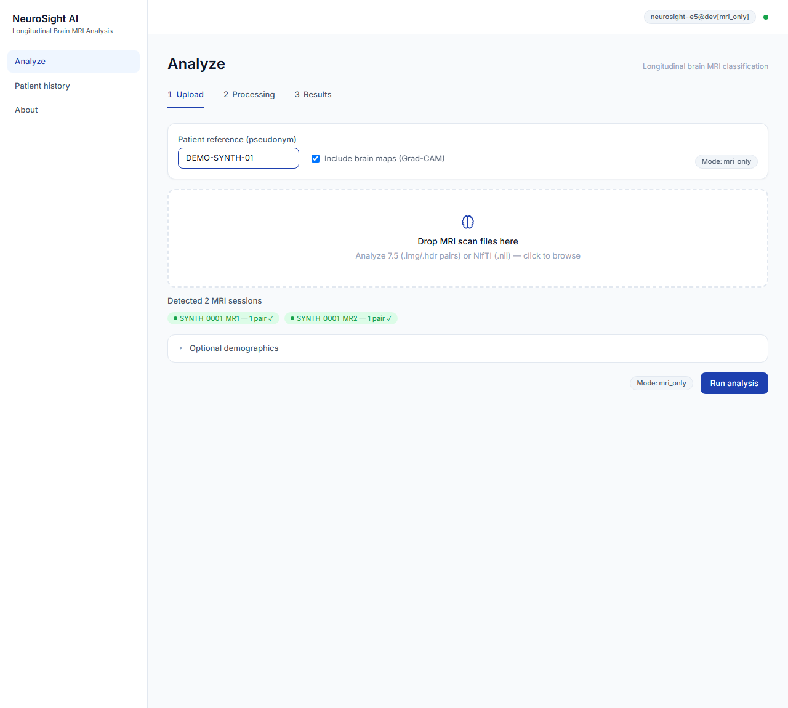
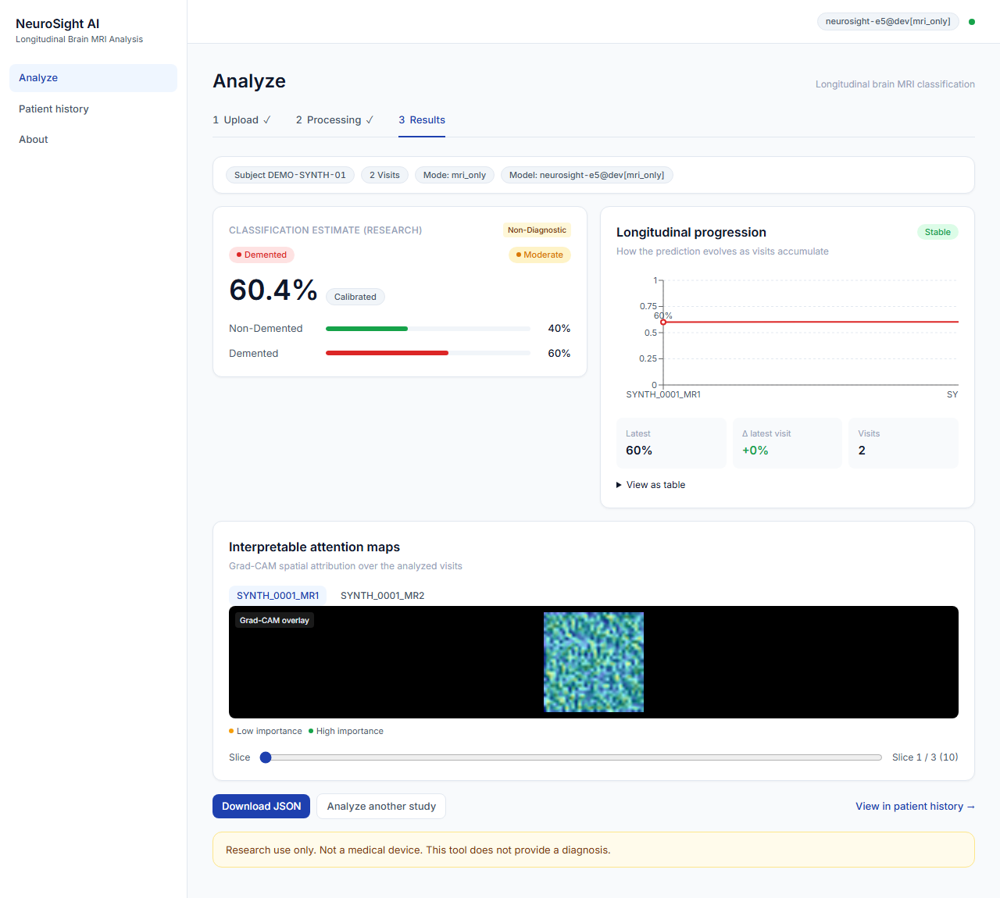
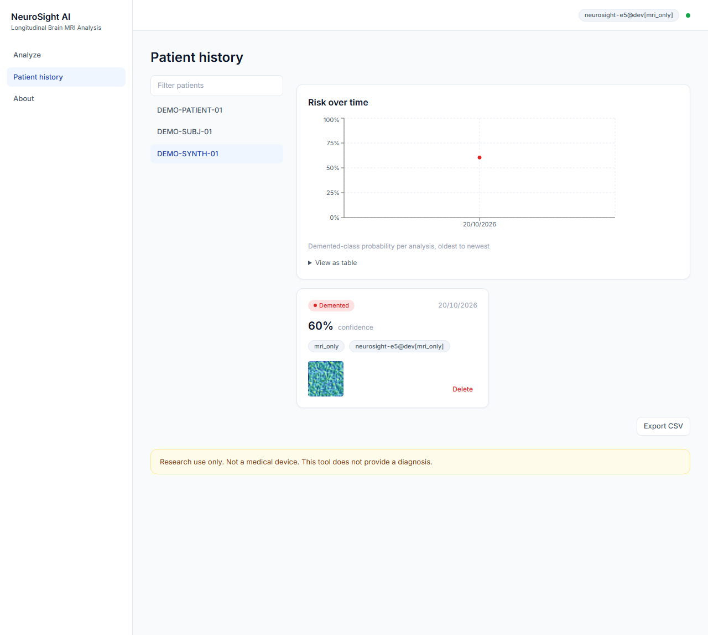
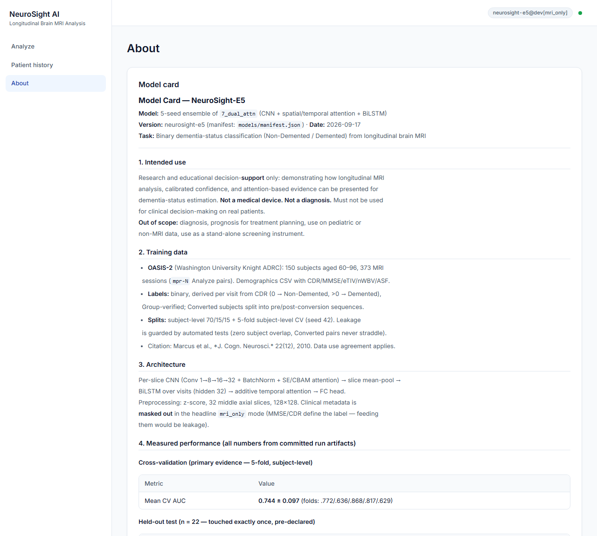

# NeuroSight AI — Longitudinal Brain MRI Analysis

[](LICENSE)
[](pyproject.toml)
[](frontend/package.json)
[](https://pytorch.org/)
[](https://fastapi.tiangolo.com/)
[](frontend/)

> **RESEARCH USE ONLY · NOT A MEDICAL DEVICE · NON-DIAGNOSTIC**<br>
> NeuroSight AI is an academic research and educational decision-support project for longitudinal brain MRI analysis on the OASIS-2 dataset. It is **not** a clinical diagnostic tool and must never be used for treatment planning, medical intervention, or diagnostic decisions on human patients.

---

## Overview

Dementia status estimation from neuroimaging requires modeling both fine-grained spatial neurodegeneration patterns across brain slices and subtle temporal disease trajectories across longitudinal visits spaced months or years apart.

NeuroSight AI provides:
1. **Leakage-Guarded ML Pipeline:** Strictly subject-partitioned splits (zero subject overlap between folds/sets; converted subjects never straddle splits; diagnosis-defining clinical scores MMSE and CDR masked out during MRI-only training).
2. **11-Variant Systematic Ablation:** From simple slice pooling (CNN-Avg) to spatio-temporal attention networks (SE-CNN, Dual Attention, 3D-CNN, 3D-LSTM, Transformers).
3. **5-Seed Deployed Ensemble (`NeuroSight-E5`):** Averaging probabilities across 5 random seeds of the dual-attention champion architecture (`7_dual_attn`), calibrated via fitted binary temperature scaling ($T = 0.6573$).
4. **Ensemble Grad-CAM Saliency:** Gradient-weighted class activation mapping averaged across all 5 ensemble members, highlighting anatomical brain regions driving the model's estimate.
5. **Decoupled Serving & UI:** An asynchronous FastAPI serving plane with single-GPU FIFO worker queue and a responsive React 18 + TypeScript + Tailwind CSS clinical dashboard.

---

## Evaluated Performance & Statistics

All metrics below reflect the declared, frozen held-out test evaluation ($n = 22$ subjects) evaluated in `scripts/bakeoff_e5.py` and documented in [`reports/excellence/bakeoff_e5.json`](reports/excellence/bakeoff_e5.json) and [`MODEL_CARD.md`](MODEL_CARD.md). Cross-validation baseline metrics reflect 5-fold evaluation documented in [`reports/csv/cv_7_dual_attn_mri_only.json`](reports/csv/cv_7_dual_attn_mri_only.json).

| Metric | Cross-Validation (5-Fold) | Held-Out Test Set ($n = 22$) | Notes |
|:-------|:--------------------------|:----------------------------|:------|
| **Primary Metric (AUC-ROC)** | **0.744 ± 0.096** | **0.777** | Subject-level evaluation |
| **Accuracy** | **69.6% ± 6.9%** | **59.1%** | 95% bootstrap CI: [36.4%, 77.3%] |
| **F1 Score** | — | **0.571** | Binary classification (CDR > 0) |
| **Raw Calibration Error (ECE)** | — | **0.273** | Uncalibrated softmax probabilities |
| **Calibrated ECE ($T = 0.6573$)** | — | **0.227** | Fitted on selection split, evaluated on test |
| **Split-Conformal Coverage** | — | **54.5%** | Target 90% (sample-efficiency bound on small $n=22$) |
| **McNemar vs Single Champion** | — | $\chi^2 = 0.000, p = 1.000$ | Identical binary decisions on $n=22$ test cohort |

*Honest evaluation note:* The small test cohort ($n = 22$) yields wide bootstrap confidence intervals ($[36.4\%, 77.3\%]$). This limitation is transparently disclosed in all model cards and user interfaces. In cross-validation, fold-level F1 and ECE metrics were not recorded in the split summary artifact.

---

## User Interface & Workflow

### 1. Study Upload & Multi-Visit Configuration
Upload Analyze 7.5 (`.img`/`.hdr` pairs) or NIfTI (`.nii`) scans. The wizard groups files automatically by longitudinal visit (e.g., `MR1`, `MR2`), validates slice headers, and accepts an optional pseudonymized patient reference.



### 2. Multi-Visit Results & Ensemble Saliency
Visualizes the classification estimate, raw and calibrated probability bars, longitudinal progression trend across visits, and 5-model averaged Grad-CAM heatmaps for key axial slices (slices 10, 16, 24).



### 3. Longitudinal Patient Timeline
Tracks historical analyses for each patient pseudonym (`/patient?subject=<id>`), charting risk trajectory and visit intervals across time.



### 4. Interactive Model Card & Telemetry
In-app documentation displaying live backend telemetry (`model_version`, device, uptime), training splits, hyperparameter ablation, and clinical caveats, formatted with structured Markdown rendering.



---

## Architecture

```
Longitudinal MRI Scan Series (Visits 1..T)
   │
   ▼
[Preprocessing & Normalization]
   │  - 32 middle axial slices (128x128 resolution)
   │  - Z-score intensity normalization
   ▼
[Per-Slice CNN Backbone (Conv2d 1→8→16→32 + BatchNorm + ReLU)]
   │
   ▼
[Spatial Attention (CBAM) + Channel Attention (SE)]
   │  - Highlights localized cortical and ventricular features
   ▼
[Slice-Level Mean Pooling] -> (T, 32)
   │
   ▼
[Bidirectional LSTM (hidden=32)]
   │  - Captures inter-visit progressive neurodegeneration
   ▼
[Temporal Additive Attention Head] -> Context Vector
   │
   ▼
[Linear Classifier Head] -> Logits
   │
   ▼
[5-Seed Ensemble Softmax Mean] -> Raw Probabilities
   │
   ▼
[Temperature Scaling (T = 0.6573)] -> Calibrated Probabilities
   │
   ▼
[Ensemble Grad-CAM Overlays] (Average across seeds 42–46 at cnn.cnn.8)
```

---

## Quick Start (Local Development)

### Prerequisites
- **Python:** 3.11 or higher
- **Node.js:** 18 or 20 LTS (`npm` 9+)
- **Git**

### 1. Clone Repository & Install Backend
```bash
git clone https://github.com/krishnav0411/neurosight-ai.git
cd neurosight-ai

# Create virtual environment
python -m venv .venv

# Activate virtual environment
# Windows PowerShell:
.venv\Scripts\Activate.ps1
# Windows CMD:
# .venv\Scripts\activate.bat
# Linux / macOS:
# source .venv/bin/activate

# Install package with development dependencies
pip install -e ".[dev]"
```

### 2. Install Frontend Dependencies
```bash
cd frontend
npm install
cd ..
```

### 3. Launch Services

#### Terminal 1 — Backend API (FastAPI)
```bash
# Windows PowerShell:
$env:NEUROSIGHT_API_KEY="dev-key"
uvicorn neurosight.api.main:create_app --factory --port 8000

# Linux / macOS:
# export NEUROSIGHT_API_KEY="dev-key"
# uvicorn neurosight.api.main:create_app --factory --port 8000
```
*Health check:* Verify `http://127.0.0.1:8000/health` returns `status: ok` and `model_version: neurosight-e5@dev[mri_only]`.

#### Terminal 2 — Frontend Clinical Dashboard
```bash
cd frontend

# Development mode (with HMR on port 5173):
npm run dev

# Or Production Preview mode (port 4173):
# npm run build
# npm run preview -- --port 4173
```

Open `http://localhost:5173` (or `http://localhost:4173`) in your browser. Enter the demo key `dev-key` when prompted.

### 4. Running a Smoke Test with Synthetic Scans
To test analysis without downloading the OASIS-2 dataset, deterministic synthetic NIfTI files are provided in `tests/fixtures/sample_scans/`:
- Upload `tests/fixtures/sample_scans/SYNTH_0001_MR1_mpr-1.nii` as Visit 1
- Upload `tests/fixtures/sample_scans/SYNTH_0001_MR2_mpr-1.nii` as Visit 2
- Click **Run analysis** to execute end-to-end inference and view live Grad-CAM heatmaps.

---

## Verification & Quality Gates

The codebase includes comprehensive test suites across backend and frontend:

```bash
# Backend unit & integration test suite (193 hermetic tests)
pytest -v

# Code formatting & linting
ruff check .
black --check .

# Frontend unit & component tests (150 tests across 21 files)
cd frontend
npm test

# Frontend production build & typecheck
npm run build
```

---

## Research & Retraining Pipeline

Full replication scripts are provided in [`scripts/`](scripts/):

```bash
# 1. Dataset preprocessing & session cache (requires OASIS-2 on disk)
python scripts/preprocess.py

# 2. Single-model debug smoke run
python scripts/train.py --model 3_cnn_lstm --debug

# 3. Full 11-variant ablation cross-validation (GPU recommended)
python scripts/train.py --ablation

# 4. Same-fold ensemble & test-time augmentation (TTA) experiments
python scripts/excellence.py

# 5. Final ensemble seed training (e.g. seeds 42–46)
python scripts/train.py --model 7_dual_attn --mode final --seed 43

# 6. Held-out test bakeoff & manifest generation
python scripts/bakeoff_e5.py

# 7. PDF Report and Presentation build
python scripts/build_reports.py
```

---

## Deployment Architecture & Guide

NeuroSight AI provides reproducible configuration for cloud deployment without requiring containerization:
- **Clinical Dashboard:** Designed for hosting on platforms such as **Vercel** or Netlify as a static Vite Single-Page Application (configured via `vercel.json` / `frontend/vercel.json`).
- **Inference Plane:** Designed for hosting on **Render** (or Fly.io / Hugging Face Spaces) as a persistent Python Web Service (`uvicorn neurosight.api.main:create_app --factory --host 0.0.0.0 --port $PORT`).

Refer to [`DEPLOY.md`](DEPLOY.md) for full configuration, environment variables (`NEUROSIGHT_API_KEY`, `NEUROSIGHT_CORS_ORIGINS`), and step-by-step setup guides.

---

## Repository Structure

```
neurosight-ai/
├── .github/workflows/       # GitHub Actions CI workflow (lint, test, build)
├── configs/                 # YAML configs (data, model, training, serving)
├── docs/                    # Architecture PRDs, technical designs, runbook
│   └── images/              # Authentic non-PHI UI screenshots
├── frontend/                # React 18 + TypeScript + Vite + Tailwind CSS dashboard
│   ├── src/                 # Components (results, upload, patient history)
│   └── vite.config.ts       # Dev and preview reverse-proxy configuration
├── models/                  # Committed 5-member E5 weights (~32 MB) & manifest.json
├── reports/                 # Evaluation metrics JSONs, figures, final PDF & slides
│   ├── csv/                 # Cross-validation and ablation metrics
│   ├── figures/             # Saliency maps and training curves
│   └── final_report.pdf     # Academic report document
├── scripts/                 # CLI entry points (preprocessing, training, bakeoff)
├── src/neurosight/          # Python core package
│   ├── api/                 # FastAPI routes, job store, validation, worker
│   ├── data/                # Dataset loaders, audit, cache, preprocessing
│   ├── evaluation/          # Calibration, Grad-CAM, bootstrap metrics
│   ├── excellence/          # Ensembling, conformal prediction, TTA
│   ├── inference/           # NeuroSightPredictor serving engine
│   └── models/              # PyTorch model registry (11 variants)
├── tests/                   # Pytest test suite (193 tests)
│   └── fixtures/            # Non-PHI synthetic test scans
├── DATA.md                  # Dataset provenance, OASIS-2 DUA terms, citation
├── DEPLOY.md                # Cloud deployment runbook (Vercel + Render)
├── LICENSE                  # MIT License
├── MODEL_CARD.md            # Detailed scientific model card & disclosures
└── pyproject.toml           # Python dependencies and build metadata
```

---

## Data Provenance & Ethics

### OASIS-2 Dataset
- **Citation:** Marcus, D. S., Fotenos, A. F., Csernansky, J. G., Morris, J. C., & Buckner, R. L. (2010). Open Access Series of Imaging Studies (OASIS): Longitudinal MRI data in nondemented and demented older adults. *Journal of Cognitive Neuroscience*, 22(12), 2677–2684. [DOI: 10.1162/jocn.2009.21407](https://doi.org/10.1162/jocn.2009.21407)
- **Data Use Agreement (DUA):** Research use only under Washington University Knight ADRC terms. Raw scans and clinical metadata are **excluded** from version control.

### Model Weights & Derived Artifacts Redistribution Notice
The repository owner attests to holding confidential written authorization expressly covering public GitHub hosting and non-commercial research sharing of the specific trained neural network checkpoints (`models/*.pth`) and OASIS-derived Grad-CAM visualization artifacts included in this repository. This permission is confidential and project-specific; it does not constitute a blanket or transferable grant of downstream redistribution rights. Third parties must independently obtain required approvals under the OASIS Data Use Agreement (DUA) for any further redistribution or reuse of data-derived parameters.

---

## License

- **Source Code:** Open-source software licensed under the [MIT License](LICENSE).
- **Dataset, Checkpoints & Derived Media Notice:** The MIT License applies strictly to repository source code, scripts, and documentation. The OASIS-2 dataset, committed model checkpoints (`models/*.pth`), and derived brain MRI figures are not licensed under the MIT License. Their inclusion is supported solely by the owner's attested confidential written permission, and no downstream redistribution rights are granted under this license.
